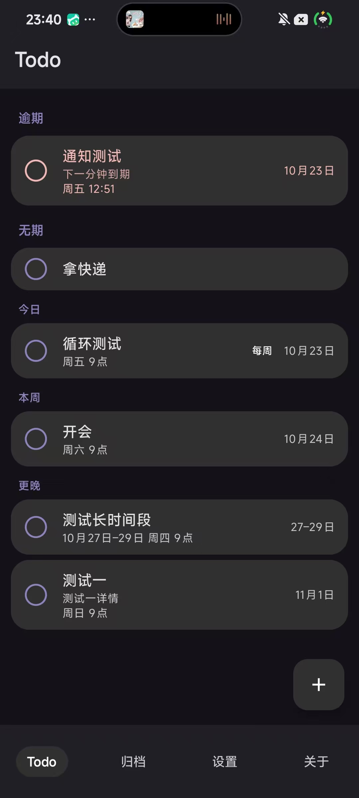
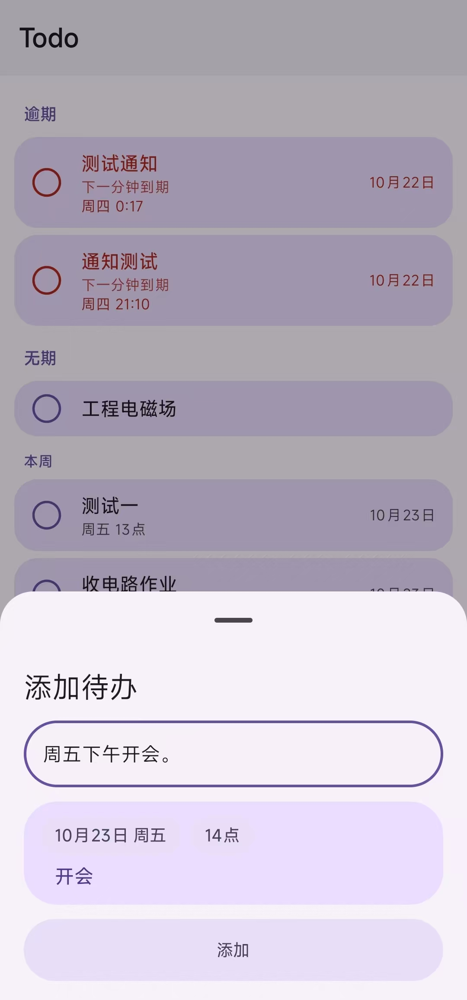
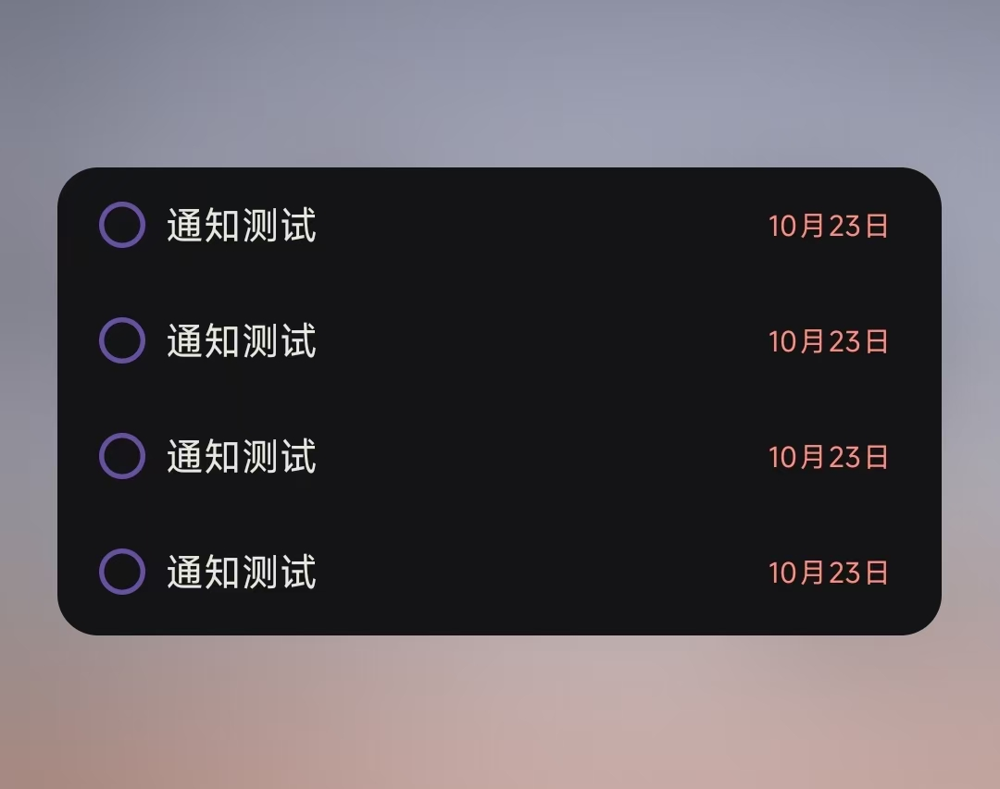
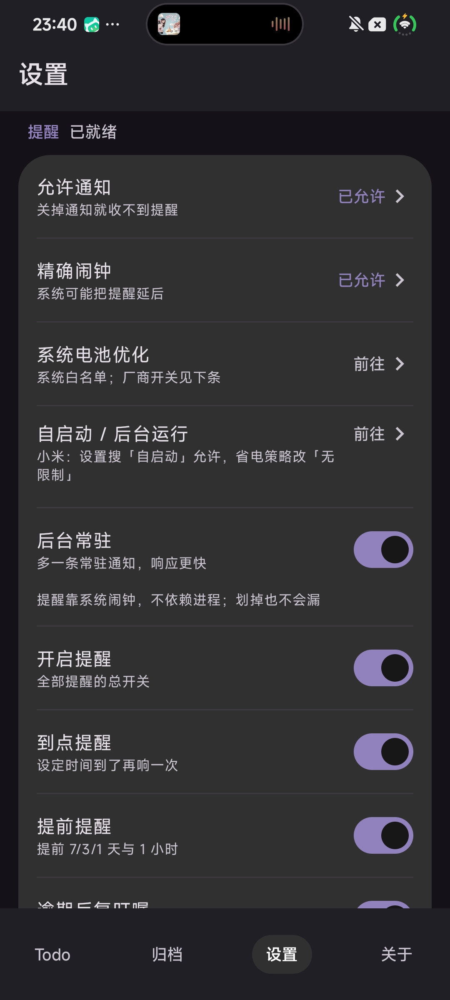
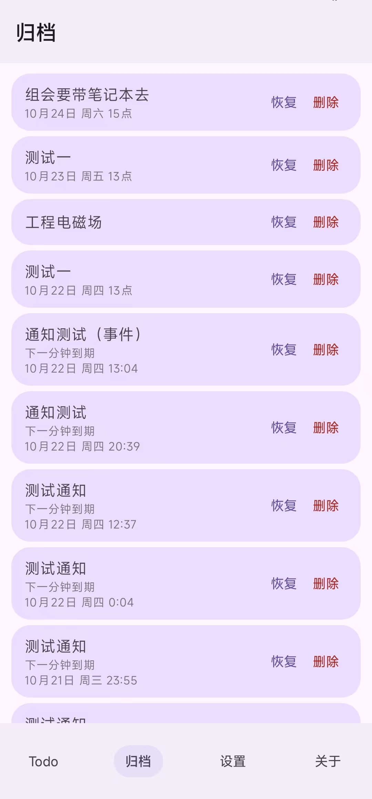

<p align="center">
  
</p>

<h1 align="center">Todo</h1>

<p align="center">
  用一句话把事情记下来，日期、时间、提醒都由它自己解析
</p>

<p align="center">
  <a href="https://github.com/zuige66/todo/releases"></a>
  
  
  
  
  
</p>

<p align="center">
  <a href="https://github.com/zuige66/todo/releases/latest"><b>下载 APK（GitHub）</b></a>
  &nbsp;·&nbsp;
  <a href="DESIGN.md">设计文档</a>
  &nbsp;·&nbsp;
  <a href="QUOTES.md">文案池</a>
</p>

<p align="center">
  <sub>当前代码版本 <b>1.0.11（versionCode 45）</b>；GitHub Release 仍停在 v1.0.2，尚未发布新版。<br />
  原「博客源」直链指向 <code>todo-1.0.0.apk</code>，博客侧早已停止同步，故移除。</sub>
</p>

---

独立的 Android 待办应用：**输入框是唯一入口**，没有日期选择器、没有分类和标签、没有账号。一句话里写了日期和时间，就自动解析并排好精确闹钟；只写了一句事，就安静地落在「无日期」里。数据全部留在本机 —— 未声明 `INTERNET` 权限，也不依赖任何在线服务。

---

## 界面截图

<p align="center">
  
  &nbsp;&nbsp;
  
  &nbsp;&nbsp;
  
</p>

<p align="center">
  
  &nbsp;&nbsp;
  
</p>

左起：**首页**（逾期 / 无期 / 今天 / 本周 / 更晚按板块分组）、**一句话添加**
（"周五下午开会。"自动解析出日期与时间）、**桌面小组件**（点行首圆圈直接完成）、
**设置**、**归档**（恢复 / 删除，删除需二次确认）。

---

## 目录

- [界面截图](#界面截图)
- [为什么是"一句话"](#为什么是一句话)
- [一句话输入](#一句话输入)
- [首页](#首页)
- [提醒](#提醒)
- [完成与重复](#完成与重复)
- [专注](#专注)
- [外观](#外观)
- [设置项一览](#设置项一览)
- [数据导出与本地备份](#数据导出与本地备份)
- [技术实现](#技术实现)
- [项目结构](#项目结构)
- [构建与运行](#构建与运行)
- [两条贯穿全局的约定](#两条贯穿全局的约定)
- [文档](#文档)

---

## 为什么是"一句话"

大多数待办应用记一件事要经过：新建 → 点日期 → 选日历 → 滚时间 → 填标题 → 选提醒。六个动作记一件事，摩擦比事情本身还大。

真正的待办都是**想起来的那一秒**产生的——走在路上、开会中途、刷牙的时候。这一秒能给的只有一句话。所以本应用的输入框是唯一的入口，没有日期选择器，没有时间滚轮，没有分类和标签。

一句话说清楚就够了：

| 你说 | 得到的待办 |
|---|---|
| `今天开会` | 今天 · 标题「开会」 |
| `明天下午4点 交周报` | 明天 16:00 · 标题「交周报」 |
| `周五 下午3点 组会 要带笔记本` | 本周五 15:00 · 标题「组会」· 详情「要带笔记本」 |
| `十号 交房租` | 本月 10 日 09:00 · 标题「交房租」（若本月 10 日已过则顺延到下月 10 日） |
| `十二月三十一号 跨年` | 12 月 31 日 09:00 · 标题「跨年」 |
| `8:30 晨会` | 今天（已过则明天）08:30 · 标题「晨会」 |
| `晚上11:50 睡觉` | 今天 23:50 · 标题「睡觉」 |
| `每天 8点 吃药` | 08:00 · 每天重复 · 标题「吃药」（今天的 8 点已过则从明天开始） |
| `明天，后天 开会` | **两条**待办：明天一条、后天一条，标题都是「开会」 |

---

## 一句话输入

```
周五 下午3点 交周报
└┬─┘ └──┬──┘ └─┬─┘
 日期   时间    事件
```

解析器是**纯离线的规则引擎**，不联网、不调用任何模型，正则与词表都在本地。

### 支持的日期写法

| 类别 | 写法 |
|---|---|
| 相对天 | 今天、明天、后天、大后天 |
| 本周 | 周四、星期四、礼拜四、本周四、这周四、这个星期四 |
| 下周 | 下周四、下个星期四、下礼拜四、**下下周四**（+2 周） |
| 月日 | 1月2日、一月二日、12月三十一号 |
| 纯日号 | 5号、十五号、二号 |
| 时间段 | `25号到1号`、`10月24日到26日`、`10月28日到11月3日`（跨月自动补上月份；开始日==结束日按单日算） |
| 数字短日期 | `1.2` / `26.1.2` / `2026.1.2`（分隔符支持 `.` `-` `/`，两位年份按 20yy） |
| 周末 | 周末（**锚在周六**：今天周六=今天，否则下一个周六；周日算下周六）、这周末 / 本周末 / 下周末（+1 周） |
| 年份词 | 今年、明年、下一年 |
| 月份词 | 本月、这个月、下个月（可再接 `X月` / `X日`） |
| 年/月边界 | 月底 / 月末 / 月初（**月**边界）、年底 / 年末 / 年终 / 年初（**年**边界：12-31 / 下一个 1-1）、`今年年底` `明年初` |
| 容错 | 全角数字与全角冒号、点号会先归一化（`８：３０` → `8:30`） |

中文数字支持到三十一，`1月二日`、`十二月三十一号` 都能读。

### 支持的时刻写法

- `15:30`、`15：30`
- `3点`、`下午3点`、`晚上11点`
- `3点半`、`3点一刻`、`3点三刻`、`3点20分`
- **时间区间**：`下午3点到5点`、`3点~5点`、`9:00-10:30`（连接词：`到` `至` `~` `～` `—` `–` `-`）
  - ★ 结束时刻**继承开始时刻的时段词**：「下午3点到5点」是 15:00–17:00，不是 15:00–05:00；
    跨午夜的写法（「晚上11点到凌晨1点」）结束点落在次日。
  - 提醒仍只在**开始点**响；**逾期看结束点** —— 16:00 的「15:00~17:00」是进行中，不标红、也不唠叨。

**时段词带默认时刻**，只写时段不写具体时间时用它：

| 时段词 | 默认时刻 |
|---|---|
| 半夜 | 00:00 |
| 凌晨 | 01:00 |
| 清晨 | 06:00 |
| 早晨 / 早上 / 上午 | 08:00 |
| 中午 | 12:00 |
| 下午 | 14:00 |
| 傍晚 / 晚上 | 18:00 |
| 夜里 | 22:00 |

`今晚`、`明晚`、`后晚`、`今夜` 这类词还会让后面的裸小时发生 12→24 小时换算，`今晚8点` = 今天 20:00。

### 标题与详情

去掉日期时间之后剩下的部分，**第一个词是事件标题，其后全部是详情**：

```
周五 下午3点 组会 要带笔记本和充电器
              └┬┘ └───────┬───────┘
             标题         详情
```

### 几个刻意的判断

解析器在歧义处的取舍是明确写进代码的，不是"随便选一个"：

- **本周里已经过去的星期** → 报错 `dateError`，不会自作主张推到下周。你说"周四"，今天是周五，那说明你记错了，应该告诉你，不该偷偷改。
- **没写年份、算出来是过去的日期** → 静默顺延（月日推到明年，日号推到下个月）。因为 `1月2日` 本来就是循环的写法，顺延符合预期。
- **写死了年份、算出来是过去的日期** → 报错。`2026年1月2日` 指的是确定的某一天，它过去了就该提醒你。
- **只写时刻、今天已过** → 顺延到明天。`3点开会` 下午说的，指的是明天下午 3 点。
- **显式写了"今天"但时刻已过** → 报错，不静默顺延。你已经指定了是哪一天。
- **相对提醒**：`马上去开会`（+5 分钟）、`一会儿下楼`（+15）、`待会儿吃饭`（+30）、`稍后回电`（+60）
  → 以「现在」为锚点给出具体时刻，跨午夜自动滚到明天；已经写了日期时只补时刻（`周五 待会儿聊聊`）。
  「火车晚点」「看一会儿书」这类**复合词**不会被当成相对提醒（词尾的相对词不参与「文字+日期」扫描）。
- **一句话里有多个日期** → 生成多条待办，一次性录入。写「明天，后天 开会」，得到两条待办。
  预览卡片上有「合并为时间段」开关：想把「24号25号 出差」当成**一段**时间（起止取最早/最晚日期）而不是两条单日，点它即可；再点「拆成多条」切回。

---

## 首页

待办按**板块**分组，板块顺序可调整、可隐藏：

```
逾期      ← 过了时间还没做的，统一标红
有日期    ← 未来的待办
无日期    ← 只记了一件事，没定时间
```

「有日期」内部再分档位：**今日 / 明天 / 后天 / 本周 / 下周 / 更晚**，多选。

档位的归并规则：没勾的档位会并到**其后第一个已勾的档位**里；如果后面没有已勾的，由最后一个已勾的兜住。这样无论怎么勾，数据都不会凭空消失——只勾「今日」时，下周的待办会落在「今日」这一档里，而不是不见。

列表每一行右侧是 `[重复徽章] 日期`，第二行是周几与时间。逾期用醒目的颜色标记，且**每 20 秒刷新一次**——界面会自己从「今天」翻成「已逾期」，不需要退出重进。

时间段的行右侧显示的是区间（如 `10月27日–29日`）而不是单个日期；进行中的区间不标红，因为逾期只看结束日。

---

## 提醒

提醒建立在 **AlarmManager 精确闹钟**上（`USE_EXACT_ALARM`），不是靠轮询，也不依赖后台常驻。

一条有精确时刻的待办，会有这些提醒点：

| 时刻 | 内容 |
|---|---|
| 提前 7 天 | 提前一周提醒 |
| 提前 3 天 | 提前 3 天提醒 |
| 提前 1 天 | 明天到期 |
| 提前 1 小时 | 1小时后到期（仅当写了精确时刻） |
| 开始日当天 | 今天开始（仅时间段；时刻取「只写日期时的默认提醒时刻」，默认 09:00） |
| 到点 | 该办了 |
| 逾期后 | 还没完成，别忘了哦（按间隔反复，默认每天） |

### 通知

通知标题的版式是 `事件 + 空格 + 标题模板`，模板里的 `{提醒}` 会换成当前提醒类型的状态语：

```
模板：🚀🚀{提醒}⏳⏳
到点   → 开组会 🚀🚀该办了⏳⏳
提前   → 开组会 🚀🚀提前3天提醒⏳⏳（按提前天数自动显示：7 / 3 / 1 天）
完成   → 开组会 🎉🎉（走「完成后后缀」，不再用模板）
```

标题模板和完成后后缀都在设置页的**一个**「通知标题」区域里编辑，保存后立即生效，
下方预览同时给出「到点 / 提前提醒 / 已完成」三种效果。清空模板只会留下事件名，
不会拼出双空格；`{提醒}` 也可以删掉，那时四种提醒共用同一句固定标题。

通知正文是同一条待办的文案（见 [QUOTES.md](QUOTES.md)），按待办 id 取模选取，所以同一条待办从生到死永远是同一句，点「完成」「撤回」来回切换也不会变。

文案池可以在 **设置 → 提醒文案** 里改：默认收起，点开是一个多行输入框，每行一条。改完点保存立即生效；清空后保存会恢复内置的 19 条。文案池一旦变化，取模基数跟着变，同一条待办的句子会换一次——改了文案还坚持用旧的才是更奇怪的行为。

通知带一个动作按钮，点「完成」后**同一条通知原地翻转**成已完成态（标题换成 `事件 🎉🎉`，按钮变成「撤回」），不会叠出第二条通知。点「撤回」则恢复原状并回到列表。

> 折叠状态下，正文只有一行，动作按钮的位置由系统通知栏决定。国产 ROM（澎湃 / MIUI / ColorOS）通常在通知展开后才渲染动作行。

---

## 完成与重复

两种归档方式，走的是同一套状态机：

- **点圆圈**：圆圈用 650ms 填满，然后归档。归档的计时器挂在 ViewModel 上，
  所以点完立刻快速滑动、切换页面都不会丢 —— 行被列表回收，任务照样会归档。
- **向右滑动卡片**：滑过 96dp 就归档（滑动过程中右侧会露出「归档」提示，没滑够会弹回去）。

归档后底部会浮出一条「已完成」提示，3 秒内可以点「撤销」把它拿回来；重复任务不显示这条提示（它不是归档，而是顺延）。

给待办加重复（每天 / 每周 / 每月）之后，完成它**不会归档**，而是顺延到下一次：

```
每天 8点 吃药  →  完成后自动变成明天 8:00
```

这样"每天"的任务永远只有一条在列表里，不需要每天重新创建。

---

## 专注

首页顶栏右侧的秒表图标 → 整页专注界面，页内「计时 / 统计」两态。

**它不是第五个 tab。** 专注是一个临时模式（25 分钟就退），底部导航那四项是常驻浏览页。
把专注塞进去，等于把它和「关于」这种低频页摆在同一层级，四个已有入口的语义一起变糊。
用覆盖层还有一个好处：专注页能整页铺满、盖住底部导航，视觉上和列表页彻底分开。

### 计时

两种模式，随时切换，上次用的会记住：

| 模式 | 说明 |
|---|---|
| **倒计时** | 15 / 25 / 45 / 60 分钟预设，走到 0 自动结束并响一次 |
| **正计时** | 从 00:00 往上数，没有终点，什么时候结束你说了算 |

两种模式都可暂停、可继续、可中途结束。环是**波浪圆**（照应用图标那枚印章的形状，
9 瓣），进度沿波浪路径截取，不是拿一个圆环盖在波浪底上。

暂停 / 结束两个按钮钉在**屏幕最下面**：视线在环上、手在底部，不用来回找。

计时**只依赖时间戳**：开始时记下 `startedAt`，显示时用「现在 − startedAt」做差，
UI 每秒只是重绘。所以掉帧、卡顿、被系统冻结都不会让专注时长变短 ——
用协程 `delay` 累加是这套东西最常见的错法，息屏回来就少几十分钟。

保活也**不用前台服务**：倒计时交给系统渲染，到点由 AlarmManager 精确闹钟拉起接收器。
代价是没新增任何权限，也没有前台服务类型的审核材料。

> 正计时不排闹钟 —— 它没有终点。通知栏的 `chronometer` 从倒计时改成往上数。

### 中途结束怎么算

| 已过时长 | 处理 |
|---|---|
| ≥ 60 秒 | 直接记入统计，标记「提前结束」 |
| 1–59 秒 | 弹窗问「要记下来吗」，用户自己决定 |
| 0 秒 | 什么都不留 |

40 分钟的提前结束不该因为"没走完"就白干；30 秒既可能是误触、也可能是真的开了个头，
只有用户自己知道 —— 所以短的问一句，长的直接算。

> 通知栏上点「结束」不弹窗：那里弹不出对话框，口径退化成「够长就记、太短当没发生」。

### 统计

- 今日 / 本周 / 累计（时长 + 次数），**本周从周一起算**
- 连续专注天数 —— 今天还没记时从昨天往前数，早上打开 App 不会看到清零
- 最近 7 天柱状图、近 15 周热力图（一格一天，五档深浅）、记录列表（最近 100 条）

跨午夜的专注整段算在**开始那天**：23:50 开始、00:20 结束的 30 分钟算前一天，
不会被劈成两半。

### 和待办的关系

**完全独立**，不绑定任何待办。删掉待办也不会带走历史时长 ——
时长记的是"我坐了多久"，不是"这条待办花了多久"。

---

## 外观

基于 Material 3 Expressive，支持浅色、深色、跟随系统三种模式。

**11 套配色**，分两组：

| 平衡 | 雅紫 · 青碧 · 海蓝 · 暖橙 · 玫瑰 · 森林 |
|---|---|
| **鲜艳** | 电光紫 · 荧光青 · 亮橙红 · 电光蓝 · 玫红 |

深色模式的卡片底色有四档可选（不染色 / 淡彩 / 标准暗色 / 深彩，默认**不染色**）。深色底上的色彩强调走"抬明度、保色相"，而不是把颜色混进背景——前者得到的是深色版的红与青，后者只会得到发灰的脏色。

**沉浸式顶栏**（默认关，可在「外观」里打开）：打开后列表向下滚动时标题栏收起，向上滚立刻回来；关掉就是固定顶栏。

应用图标是一枚紫色的波浪花瓣印章，中间压着一道白色对勾。关于页有滚动联动的渐变背景与淡出效果。

---

## 设置项一览

| 分区 | 内容 |
|---|---|
| 提醒可靠性 | 四条自检（通知 / 精确闹钟 / 系统电池优化 / 自启动）+ 后台常驻开关；标题带「已就绪 / N 项需处理」徽章 |
| 提醒 | 提醒总开关、到点提醒、提前提醒、逾期反复叮嘱与间隔、只写日期时的默认提醒时刻 |
| 通知 | 三个并列的折叠项：**通知模板**（标题模板 + 完成后缀 + 三种预览）、**提醒文案**（通知正语文案池）、**常驻通知文案**（后台常驻那条通知的标题/正文） |
| 外观 | 主题模式、配色（11 套）、沉浸式顶栏、深色卡片底色（四档） |
| 小组件 | 显示日期、日期位置（标题下方 / 标题右侧）、只显示日期、隐藏头部 |
| 列表与待办 | 板块排序与显隐、有日期档位（多选）、自动顺延 |
| 测试 | 发送测试通知、创建下一分钟到期的测试待办（位于全页最底部） |

底部导航四项：**Todo / 归档 / 设置 / 关于**。「关于」独立成页，设置页不再重复入口。

---

## 桌面小组件

固定显示最近 **4 条**待办，行首圆圈取当前配色的主色，**点圆圈直接归档**（先亮起勾，再整行收走）。

日期怎么显示由四个开关决定，**与组件尺寸无关**：

| 开关 | 说明 |
|---|---|
| 显示日期 | 总开关；关掉只显示事件 |
| 日期位置 | 标题下方（事件优先，标题占满整行）/ 标题右侧（日期优先，日期永远完整） |
| 只显示日期 | 开＝「10月23日」，关＝「10月23日 14点」 |
| 隐藏头部 | 顶部「待办」标题与条数 |

> 组件拉到 2×2 还是 2×4 都不影响上面的行为。部分桌面（如 vivo）回报的组件尺寸恒为同一值，
> 按尺寸切换布局必然判错，所以这里根本不看尺寸。

添加方式：长按桌面空白处 → 小组件 → 搜「Todo」。

---

## 隐私与网络

**本应用不申请任何网络权限。**

- v1.0.0 起下线了应用内「检查更新」—— 国内应用商店一律禁止应用内下载安装 APK，属必拒项
- 关于页的 GitHub / 博客链接点击后交给系统浏览器打开 —— 联网的是浏览器，不是本应用
- 首次启动弹隐私政策同意弹窗；点遮罩和返回键都关不掉，不同意则退出应用
- 权限申请（通知等）一律在**同意隐私政策之后**才发起
- 待办数据只在本机，且已关闭系统云备份（`allowBackup=false`）

---

## 数据导出与本地备份

「设置 → 数据」里可以把**待办（含归档）、全部专注记录和设置项**导出成一个文件，也可以从文件恢复。

- **纯本地、零新增权限**：走 Android 系统文件选择器（SAF），只对你选中的那一个文件读写字节流；不申请 `INTERNET`、不上传、不读取其它文件。
- **明文 JSON**：文件人能直接读、也能手工改，但**拿到文件的人就能看到你的全部待办**，请自行保管。
- **恢复三选一**：整份覆盖 / 保留并导入（追加，可能重复）/ 去重导入（按 id 跳过重复）。两道确认：先看清条数与导出时间、选模式（可取消），再确认一次才写入。
- **不进备份的两类东西**：正在进行的专注（避免复活成僵尸计时）、隐私政策同意版本（避免重新弹同意或绕过同意）。
- 恢复后会重建全部提醒闹钟、刷新桌面小组件，并重建界面让设置项重新生效。

> 与 `allowBackup=false` 不冲突：这里是**你主动发起**的一次文件导出，系统自动备份仍然关闭。

---

## 技术实现

| | |
|---|---|
| 语言 | Kotlin |
| UI | Jetpack Compose + Material 3 Expressive |
| 存储 | Room（schema v7）+ SharedPreferences |
| 提醒 | AlarmManager 精确闹钟 + BroadcastReceiver |
| 导航 | 单 Activity，Compose 内部状态切换（4 个 tab + 专注覆盖层） |
| 最低版本 | Android 8.0（API 26） |
| 编译 / 目标 | API 36 |
| 版本 | 1.0.11（versionCode 45） |
| 包名 | `com.lirui.oneline` |
| 网络 | **不申请任何网络权限**（v1.0.0 起，检查更新已下线） |

### 数据模型

```kotlin
@Entity(tableName = "todos")
data class Todo(
    val id: Long,
    val title: String,        // 事件标题
    val detail: String,       // 详情
    val dueAtMillis: Long?,   // 到期时刻；null = 无日期
    val startAtMillis: Long?, // 时间段开始日；null = 单日
    val hasExactTime: Boolean,// 是否给了精确时刻，决定是否发 T-1h 提醒
    val repeatDays: Int,      // 重复步长：1 每天 / 7 每周 / 30 每月
    val archived: Boolean,
    val createdAt: Long,
    val completedAt: Long?
)
```

### 提醒链路

```
ReminderEngine   算出所有提醒点（时间 + 类型）
      ↓
ReminderScheduler 排进 AlarmManager，用 PendingIntent 指向 ReminderReceiver
      ↓
ReminderReceiver  闹钟响 → 查库 → 发通知 → 若是逾期类，再排下一次
      ↓
NotificationActionReceiver  「完成」/「撤回」→ 复用同一个归档入口
```

`ReminderScheduler` 是唯一排逾期提醒的入口，`ReminderEngine.nextOverdueReminder()` 必须在**到期前也返回** `due + interval`，否则新建待办的唠叨链永远不会启动。这条链路是这套提醒系统的关键约束。

### 测试

329 条本地单元测试，覆盖解析器、提醒引擎、专注计时与统计、通知标题、备份规则、版本比较、格式化、时间与首页分组：

```
Compose 之外的逻辑全部是纯函数，可以直接测
ParserTest            184 条
FormatTest             29 条
HomeGroupingTest       28 条
ReminderEngineTest     26 条
FocusRulesTest         21 条
RangeMergeTest         11 条
FocusStatsTest         11 条
NotificationTitleTest   9 条
BackupRulesTest         7 条
AppTimeTest             3 条
```

备份的 JSON 流读写依赖 Android 平台 `org.json`（本地单测里是 android.jar stub），
所以单测只覆盖 `BackupRules` 的纯判定，真正的导出 / 恢复靠真机验收。

Room 迁移不在本地单测覆盖范围内，另有一组 instrumented 测试
`app/src/androidTest/.../AppDatabaseMigrationTest.kt`：用 `MigrationTestHelper` +
`app/schemas/1~7.json` 建旧版本库，验证 v1→v7 全链、v4→v5 的 `deletedAt DEFAULT NULL`
和 v6→v7 建表列对齐。需要连设备跑 `:app:connectedDebugAndroidTest`。

---

## 项目结构

```
app/src/main/kotlin/com/lirui/oneline/
├── MainActivity.kt              入口，主题与设置状态
├── OnelineApp.kt                Application：初始化数据库与通知渠道
├── backup/
│   ├── BackupRules.kt           格式/版本校验、键过滤、文件名（纯函数）
│   ├── BackupCodec.kt           明文 JSON 编解码 + 设置写回
│   └── BackupManager.kt         SAF 流读写 + 三模式恢复 + 提醒/组件重建
├── data/
│   ├── AppDatabase.kt           Room 数据库与迁移（v7）
│   ├── TodoDao.kt
│   ├── TodoRepository.kt        唯一的数据入口
│   ├── FocusDao.kt
│   ├── FocusRepository.kt       专注记录的读写入口
│   ├── model/Todo.kt
│   └── model/FocusSession.kt    一次已结束的专注
├── parser/
│   ├── Parser.kt                自然语言解析（规则引擎）
│   └── ParsedTodo.kt
├── reminder/
│   ├── ReminderEngine.kt        计算提醒点
│   ├── ReminderScheduler.kt     排程
│   ├── ReminderReceiver.kt      闹钟回调 → 发通知
│   ├── NotificationHelper.kt    通知构建与标题拼装
│   ├── NotificationActionReceiver.kt  完成 / 撤回
│   ├── NotificationDismissScheduler.kt  归档后延迟撤通知
│   ├── ReminderWatchdog.kt      每 12h 兜底重排 + 补发
│   └── BootReceiver.kt          重启后重建闹钟
├── keepalive/
│   ├── KeepAliveService.kt      后台常驻通知
│   └── DeviceCompat.kt          各 ROM 自启动 / 电池优化兼容
├── focus/
│   ├── FocusRules.kt            计时纯函数：elapsed / 剩余 / 格式化 / 取消阈值
│   ├── FocusStore.kt            进行中的专注落盘（进程被杀能恢复）
│   ├── FocusEngine.kt           专注状态机：开始 / 暂停 / 继续 / 完成 / 中途结束
│   ├── FocusNotifier.kt         倒计时与完成通知（系统 chronometer，不用前台服务）
│   ├── FocusScheduler.kt        到点精确闹钟
│   ├── FocusAlarmReceiver.kt    闹钟 → 落库 + 完成通知
│   └── FocusActionReceiver.kt   通知条上的暂停 / 继续 / 结束
├── widget/
│   ├── TodoWidgetProvider.kt    桌面小组件
│   └── TodoWidgetActionReceiver.kt  组件行首圆圈 → 直接完成
├── ui/
│   ├── MainViewModel.kt         状态与归档状态机（pendingArchive）
│   ├── FocusViewModel.kt        专注页状态（显示时钟由 UI 驱动，页面关掉不空转）
│   ├── screen/
│   │   ├── TodoListScreen.kt    首页、归档页、设置页、四 tab 导航
│   │   ├── AddSheet.kt          输入弹层
│   │   ├── FocusScreen.kt       全屏专注页（计时 / 统计两态）
│   │   ├── AboutScreen.kt       关于页（含隐私政策入口）
│   │   ├── PrivacyScreen.kt     隐私政策页 + 首次启动同意弹窗
│   └── theme/
│       ├── Theme.kt             配色与深色卡片
│       └── Tokens.kt            统一卡片/输入面/按钮语义色
├── util/
    ├── AppTime.kt               固定时区
    ├── Format.kt                日期格式化、逾期判定
    ├── HomeGrouping.kt          板块与档位分组
    ├── FocusStats.kt            专注统计聚合（今日/本周/累计/连续/热力图）
    ├── Quotes.kt                通知文案池
    └── SettingsRepo.kt          设置持久化（含通知标题模板与旧数据迁移）

app/src/test/java/com/lirui/oneline/
├── parser/{ParserTest,RangeMergeTest}.kt
├── reminder/{ReminderEngineTest,NotificationTitleTest}.kt
├── focus/FocusRulesTest.kt
├── backup/BackupRulesTest.kt
└── util/{FormatTest,HomeGroupingTest,AppTimeTest,FocusStatsTest}.kt
```

---

## 构建与运行

需要 JDK 17。项目不带 Gradle Wrapper，使用本机 Gradle 9.x。

```bash
export JAVA_HOME=/path/to/jdk17

# 单元测试
gradle :app:testDebugUnitTest

# 打包
gradle :app:assembleRelease
# → app/build/outputs/apk/release/app-release.apk

# 安装
adb install -r app/build/outputs/apk/release/app-release.apk
```

如果想在同一台设备上覆盖安装，签名必须一致；debug 包与 release 包不通用。

### 分支

| 分支 | 用途 |
|---|---|
| `main` | 主开发线，最新功能都在这里 |
| `release/vivo-store` | 国内合规 / vivo 商店上架版，含隐私政策页、软著与申报材料 |

两条线从 `e7fb97e`（1.0.0 上架改造）分叉，**功能改动要在两边各落一次**，不能只推 main。
合规分支的 `versionCode` 必须独立递增；涉及新数据存储、通知或权限时，同步更新
`docs/PRIVACY.md` 与 `PrivacyScreen`（该分支宣称「不收集统计数据」，本地统计要写清楚不上传）。
上架流程见 `docs/STORE-APPLY.md`。

---

## 两条贯穿全局的约定

### 时区固定为北京时间

全应用只用 `AppTime.ZONE`（`Asia/Shanghai`）计算，不读设备时区。设备时区变了，存下来的时间戳对应的墙钟时间不会漂移——"明天下午 3 点"永远是北京时间的明天下午 3 点。

### 逾期的判定口径

- **写了精确时刻** → 当前时间超过该时刻，就算逾期
- **只写了日期** → 过了那一天才算逾期
- **时间段（有开始日的区间）** → 同样只看结束日：结束日没到就不算逾期，进行中的区间不标红

第二条尤其重要：只写"3号"的任务，不能在 3 号早上 9:01 就被标红。默认时刻（09:00）是用来排提醒的，不是用来判逾期的。列表里的分组与标红共用同一套判定，口径必须一致。

---

## 文档

| 文件 | 内容 |
|---|---|
| [DESIGN.md](DESIGN.md) | 设计决策、解析语义、踩过的坑与源码级结论 |
| [COPY.md](docs/COPY.md) | 对外分享文案：小红书短文案 + 酷安首发长文案 |
| [QUOTES.md](QUOTES.md) | 通知文案池 |
| [SMOKE-REPORT.md](SMOKE-REPORT.md) | 真机冒烟验证记录 |
| [docs/COPYRIGHT.md](docs/COPYRIGHT.md) | 软著登记材料的生成方式、口径与踩坑（产出在 `output/软著材料/`） |

---

## 作者

[zuige](https://github.com/zuige66) · [blog.zuiges.com](https://blog.zuiges.com)
